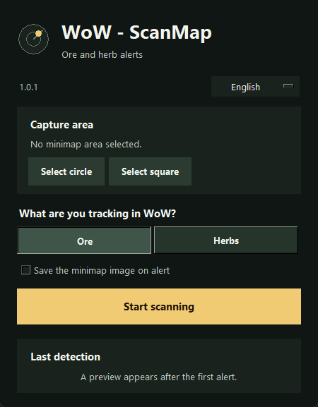

# WoW - ScanMap

[Русский](docs/README.ru.md) · **English** · [简体中文](docs/README.zh-CN.md)

**Version 1.0.1 · Windows x64**

WoW - ScanMap shows an on-screen alert and plays a Windows sound when it detects a new yellow dot on the World of Warcraft minimap.

[**Download WoWScanMap.exe**](https://github.com/VlasovDevCore/WoWScanMap/releases/download/v1.0.1/WoWScanMap.exe) · [Release notes and source archives](https://github.com/VlasovDevCore/WoWScanMap/releases/tag/v1.0.1)



## Quick start

1. Run `WoWScanMap.exe`. Python and the dependencies are bundled.
2. Open WoW in windowed mode and enable **Find Minerals** or **Find Herbs**.
3. Choose **Select circle** or **Select square** and drag diagonally around the map itself. Leave the frame and buttons outside. Use the wheel to resize or the arrow keys to move one pixel at a time. Press **Enter** or **Apply**. **Esc** cancels.
4. Select **Ore** or **Herbs** to match the active WoW tracking mode. Click **Start scanning** and return to the game.
5. Reopen the app window and click **Stop scanning** when finished.

## Settings and behavior

| Setting | What it does |
| --- | --- |
| **Русский / English / 简体中文** | Changes the interface and alerts immediately. ScanMap remembers the choice. |
| **Circle / square** | Chooses the shape of the area to scan. Use circle for the standard round minimap. |
| **Ore / herbs** | Sets the wording of the notification. This should match the tracking mode selected in WoW. |
| **Save the minimap image on alert** | Writes only the last marked image to `last_detection.png` next to the EXE or script. |

The app reads screen pixels while WoW is in the foreground. It sounds on a sustained increase in compact yellow spots. The latest alert preview outlines detected spots in pink. The scan pauses when WoW is minimized or out of focus.

Other yellow icons can trigger alerts. The round mask skips the outer 14% of the radius, so a resource at the edge can register later. Exact resource names are unavailable from the dot color. Server rules for overlays vary. [Sirus rules](https://forum.sirus.org/threads/pravila-igrovyx-mirov-sirus-su.1858/)

## Source and build

```text
WoWScanMap/
├── src/scanmap/
│   ├── minimap_alert.py    # interface, capture and detection
│   ├── translations.py     # Russian, English and Simplified Chinese
│   └── assets/ScanMap.ico  # window and EXE icon
├── scripts/build.ps1      # Windows x64 build
├── docs/                  # translated guides and interface screenshot
├── requirements.txt
└── requirements-build.txt
```

Run from source on Windows with 64-bit Python:

```powershell
python -m pip install -r requirements.txt
python src/scanmap/minimap_alert.py
```

Build the single-file EXE:

```powershell
python -m pip install -r requirements-build.txt
powershell -ExecutionPolicy Bypass -File scripts/build.ps1
```

The build outputs `dist/WoWScanMap.exe`.
